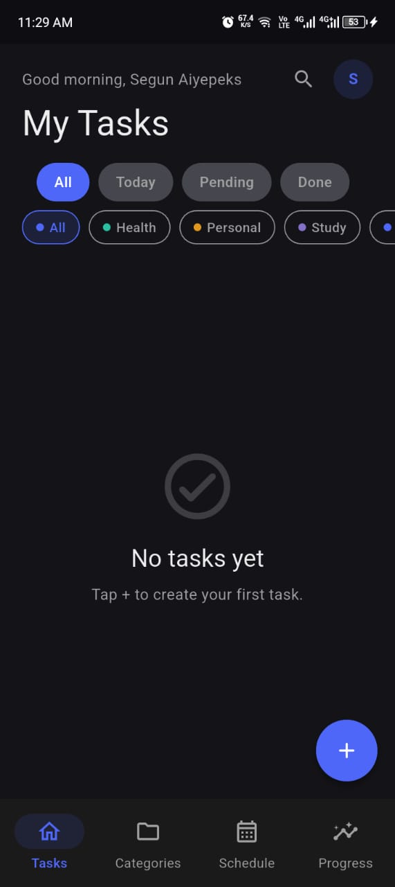
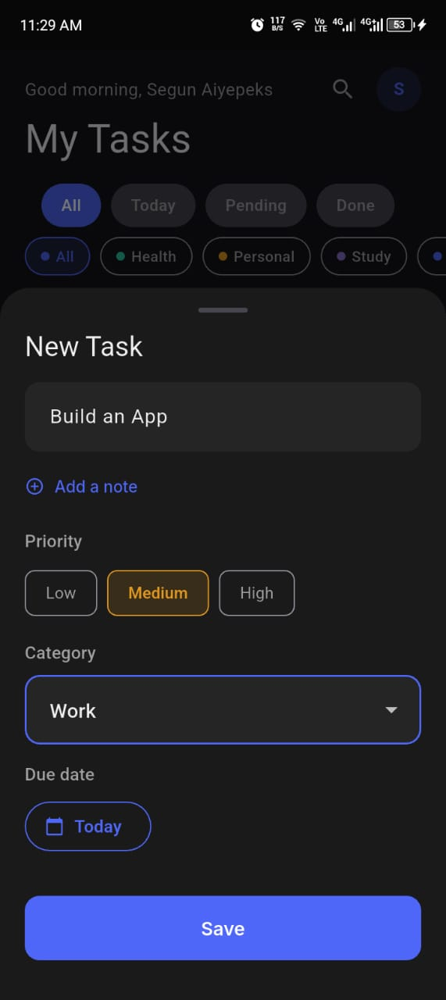
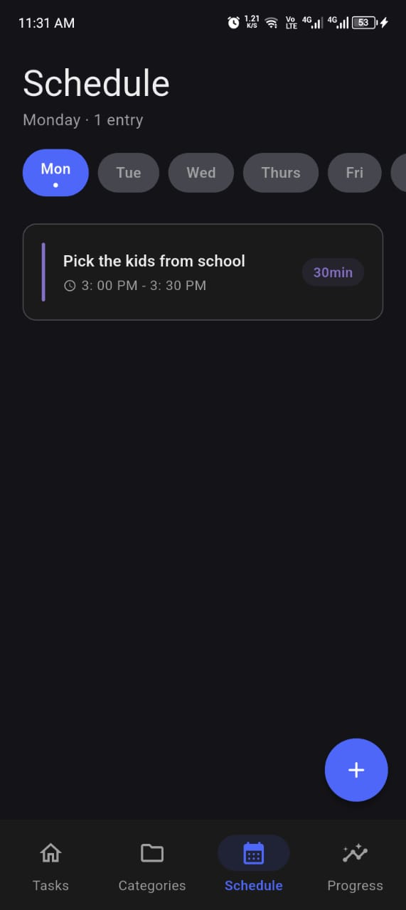
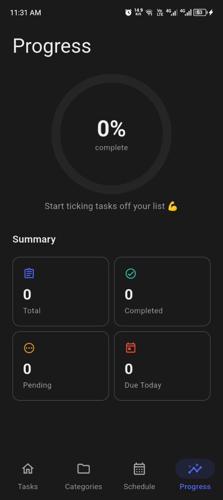

# Taskie — Your day, organised.

> A focused, offline-first task manager built with Flutter and Isar.  
> Developed by **Aiyepeks**

---

## Overview

Taskie is a commercial-grade Android task management application built as a showcase of clean Flutter architecture. It is 100% offline — your data lives on your device, no account required, no internet dependency.

The app was designed from a real UX case study with two target personas: a busy professional who needs fast, reliable task capture, and a student who needs due-date reminders and subject-based organisation.

---

## Screenshots

| Home | Task Detail | Schedule | Progress |
|------|-------------|----------|----------|
|  |  |  |  |

---

## Features

**Task management**
- Create tasks with title, description, priority (High / Medium / Low), category, and due date
- Subtasks — break complex work into smaller steps, each with its own checkbox
- Mark tasks complete or reopen them at any time
- Swipe-to-delete on task cards
- Full edit flow with pre-filled form

**Organisation**
- Custom categories with a colour and icon picker
- Filter tasks by All / Today / Pending / Done
- Filter by category chip
- Live search with 250ms debounce across title and description

**Schedule (Timetable)**
- Weekly recurring schedule — create time blocks per day of the week
- Colour-coded entries with start/end time, duration badge, and optional note
- Day selector with today indicator
- Swipe-to-delete entries

**Progress**
- Circular completion ring with percentage
- Summary stats grid — total, completed, pending, due today
- Priority breakdown bar chart

**Personalisation**
- Name capture during onboarding — greeting displays your name on the dashboard
- Initials avatar with tap-through to Settings
- Theme override — Light / Dark / System
- All preferences stored locally via `shared_preferences`

**Notifications**
- Local reminders scheduled at 9 AM on a task's due date
- Notifications update automatically when a task is edited, completed, or deleted
- Tapping a notification deep-links to the relevant task

**Onboarding**
- 3-slide intro + name capture screen on first launch
- Skip available throughout
- Never shown again after completion (`hasSeenOnboarding` flag)

**Branding**
- T-Monogram logo designed exclusively for Taskie
- Branded splash screen and onboarding attribution: *Developed by Aiyepeks*
- Custom app icon with Android adaptive icon support

---

## Architecture

Taskie follows **MVVM (Model–View–ViewModel)** architecture with strict separation of concerns across four layers.

```
View  →  ViewModel  →  Repository  →  Model
```

| Layer | Responsibility | Key files |
|---|---|---|
| **View** | Flutter widgets, zero logic | `lib/presentation/views/` |
| **ViewModel** | Business logic, UI state, `ChangeNotifier` | `lib/presentation/viewmodels/` |
| **Repository** | Data access contract (abstract) + Isar implementation | `lib/data/repositories/` |
| **Model** | Isar `@collection` schemas, computed properties | `lib/data/models/` |

### Key architecture decisions

**Abstract repository pattern** — `TaskRepository` is an interface. `IsarTaskRepository` implements it. ViewModels only ever hold a reference to the abstract type — swapping the storage engine requires changing one line in `main.dart`.

**Reactive streams** — Isar's `.watch(fireImmediately: true)` streams drive all UI updates. ViewModels subscribe in their constructor and call `notifyListeners()` on each emission. No manual refresh, no polling.

**Provider scoping** — Global ViewModels (`TaskViewModel`, `CategoryViewModel`, `StatsViewModel`, `TimetableViewModel`, `SettingsViewModel`, `AppShellViewModel`) are registered at the root `MultiProvider`. Local ViewModels (`AddTaskViewModel`, `AddEntryViewModel`, `SearchViewModel`) are scoped to the widget that needs them via `ChangeNotifierProvider` at the point of use, and disposed automatically when that widget leaves the tree.

**Service layer** — `NotificationService` is a singleton that wraps `flutter_local_notifications`. It is not a ViewModel — it has no UI state and never calls `notifyListeners()`. ViewModels call into it as a side effect of data mutations.

---

## Project structure

```
lib/
├── core/
│   ├── constants/        ← AppColors, AppSizes, AppStrings, AppEnums
│   ├── extensions/
│   ├── router/           ← go_router config with onboarding redirect guard
│   ├── services/         ← NotificationService
│   ├── theme/            ← AppTheme (light + dark, Material 3)
│   └── utils/            ← DateHelper
│
├── data/
│   ├── models/           ← Task, Category, Subtask, TimetableEntry (@collection)
│   └── repositories/     ← TaskRepository (abstract), IsarTaskRepository,
│                            TimetableRepository, IsarTimetableRepository
│
├── presentation/
│   ├── viewmodels/       ← TaskVM, CategoryVM, StatsVM, TimetableVM,
│   │                        SettingsVM, AppShellVM, AddTaskVM,
│   │                        AddEntryVM, SearchVM, TaskDetailVM, EditNameVM
│   └── views/
│       ├── screens/      ← SplashScreen, OnboardingScreen, AppShell,
│       │                    HomeScreen, TaskDetailScreen, CategoriesScreen,
│       │                    TimetableScreen, StatsScreen, SettingsScreen
│       └── widgets/      ← TaskCard, TimetableEntryCard, AddTaskSheet,
│                            AddEntrySheet, AddCategorySheet, PriorityBadge,
│                            EmptyState, DeveloperCredit, SearchField
│
├── app.dart              ← MultiProvider root + MaterialApp.router
└── main.dart             ← Isar.open(), SharedPreferences, NotificationService
```

---

## Tech stack

| Package | Version | Role |
|---|---|---|
| `flutter` | 3.x | UI framework |
| `provider` | ^6.1.2 | State management (ViewModel ↔ View) |
| `isar` + `isar_flutter_libs` | ^3.1.0+1 | Embedded offline database |
| `go_router` | ^14.2.0 | Declarative navigation |
| `shared_preferences` | ^2.2.3 | Lightweight settings storage |
| `flutter_local_notifications` | ^17.2.1 | Due-date reminders |
| `google_fonts` | ^6.2.1 | Inter typeface |
| `intl` | ^0.19.0 | Date formatting |
| `uuid` | ^4.4.0 | Unique subtask IDs |
| `path_provider` | ^2.1.3 | Device document directory |
| `flutter_launcher_icons` | ^0.13.1 | App icon generation |
| `flutter_native_splash` | ^2.4.1 | Native splash screen |

---

## Getting started

### Prerequisites

- Flutter 3.x (`flutter --version`)
- Android SDK with a connected device or emulator (API 21+)
- Java 17 (required by AGP 8.x)

### Setup

```bash
# 1. Clone the repository
git clone https://github.com/yourusername/taskie.git
cd taskie

# 2. Install dependencies
flutter pub get

# 3. Generate Isar schemas
dart run build_runner build --delete-conflicting-outputs

# 4. Generate app icon and splash screen
flutter pub run flutter_launcher_icons
flutter pub run flutter_native_splash:create

# 5. Run on a connected device
flutter run
```

### Known setup note

`isar_flutter_libs 3.1.0+1` requires a manual namespace patch for projects using Android Gradle Plugin 8.0+. Open:

```
~/.pub-cache/hosted/pub.dev/isar_flutter_libs-3.1.0+1/android/build.gradle
```

And add `namespace "dev.isar.isar_flutter_libs"` inside the `android {}` block.

---

## Building a release APK / AAB

```bash
# Signed AAB for Play Store
flutter build appbundle --release

# Signed APK for direct install
flutter build apk --release
```

See [Step 11 of the build guide](#) for keystore setup and signing configuration.

---

## Design system

All design decisions are centralised in `lib/core/constants/` and `lib/core/theme/`:

- **Primary colour**: Indigo `#4F67F8`
- **Spacing**: 8pt grid (`AppSizes.sm = 8`, `md = 16`, `lg = 24`, `xl = 32`)
- **Typography**: Inter (via `google_fonts`)
- **Theming**: Material 3 `ColorScheme.fromSeed()` with explicit overrides
- **Dark mode**: Full support — every widget references `colorScheme.onSurface` / `colorScheme.background`, never hardcoded hex

---

## Roadmap

- [ ] Cloud sync (optional, user-initiated)
- [ ] Task recurrence (daily / weekly repeating tasks)
- [ ] Widget support (home screen task count widget)
- [ ] CSV export
- [ ] Streak tracking on the Progress screen

---

## Author

**Aiyepeks**  
Flutter & Node.js developer  
[GitHub](https://github.com/coded-aiyepeks)

---

## Licence

```
MIT Licence

Copyright (c) 2025 Aiyepeks

Permission is hereby granted, free of charge, to any person obtaining a copy
of this software and associated documentation files (the "Software"), to deal
in the Software without restriction, including without limitation the rights
to use, copy, modify, merge, publish, distribute, sublicense, and/or sell
copies of the Software, and to permit persons to whom the Software is
furnished to do so, subject to the following conditions:

The above copyright notice and this permission notice shall be included in
all copies or substantial portions of the Software.

THE SOFTWARE IS PROVIDED "AS IS", WITHOUT WARRANTY OF ANY KIND, EXPRESS OR
IMPLIED, INCLUDING BUT NOT LIMITED TO THE WARRANTIES OF MERCHANTABILITY,
FITNESS FOR A PARTICULAR PURPOSE AND NONINFRINGEMENT. IN NO EVENT SHALL THE
AUTHORS OR COPYRIGHT HOLDERS BE LIABLE FOR ANY CLAIM, DAMAGES OR OTHER
LIABILITY, WHETHER IN AN ACTION OF CONTRACT, TORT OR OTHERWISE, ARISING FROM,
OUT OF OR IN CONNECTION WITH THE SOFTWARE OR THE USE OR OTHER DEALINGS IN
THE SOFTWARE.
```

---

*Developed with care by Aiyepeks · Built with Flutter*
